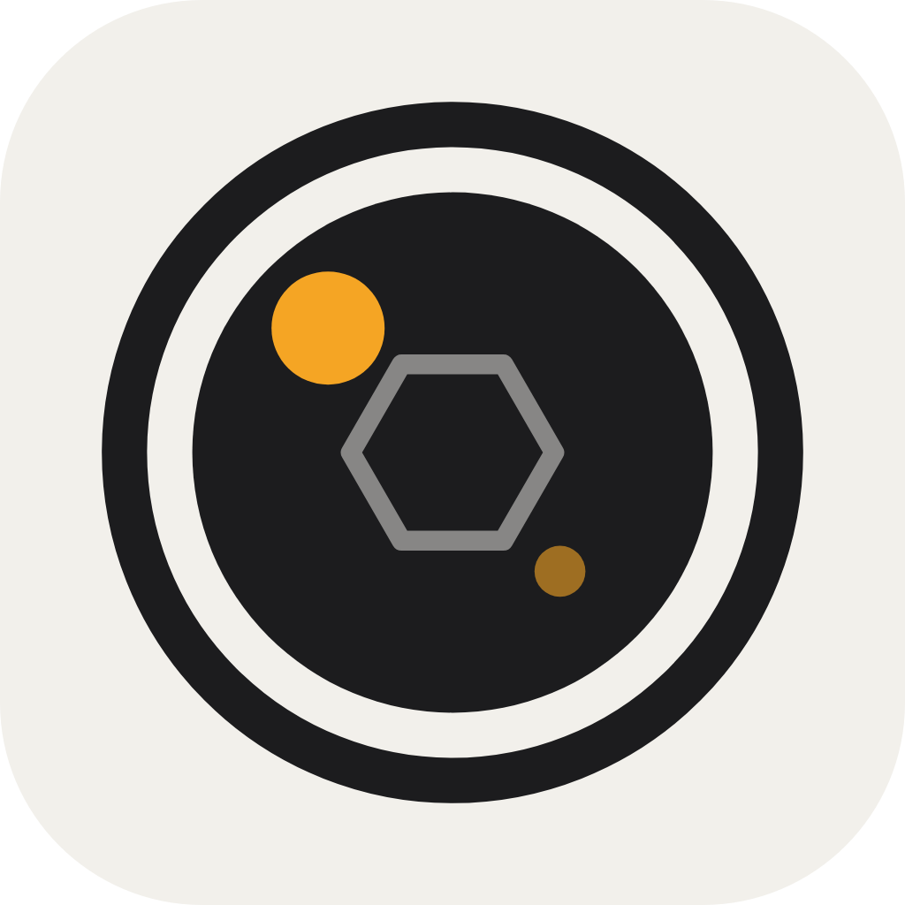

<p align="center">
  
</p>

# Glint

A raw-first iPhone camera. It captures Bayer RAW (DNG) stills with no multi-frame fusion, gives you manual control of exposure and white balance, and records video with stabilization off. Captures are saved to Photos and to the app's Documents folder (Files > On My iPhone > Glint). Only the Photos copy carries the location tag, and the Documents copies are left out of iCloud and computer backups (Photos has its own).

## Features

**Capture**
- **RAW (DNG) stills:** Bayer RAW, not Apple ProRAW, with no multi-frame fusion. FILE in SET chooses RAW (the default), HEIC or RAW+HEIC; ASPECT chooses 4:3, 3:2, 1:1 or 16:9. A DNG always keeps the full sensor; the crop is applied to the HEIC.
- **Neutral HEIC:** developed from the RAW with noise reduction, sharpening, contrast, detail, moire and boost off, so it matches the DNG. If developing fails the DNG is kept; if Bayer RAW isn't available the camera's own HEIC is saved (fusion off).
- **AUTO | MANUAL:** in MANUAL, ISO, shutter and white balance are set on a camera-style ruler in 1/3-stop steps. The A at the end of the ruler hands one setting back to the camera, giving shutter priority, ISO priority or program; the ruler then sets exposure compensation.
- **Manual focus:** a rail down the side of the viewfinder runs from NEAR to ∞, with an AF | MF switch below it. The rail only shows in MF (it slides away in autofocus), and touching it takes over from where autofocus left the lens.
- **AE/AF lock:** touch and hold the viewfinder to focus and meter once and hold both; a tap releases it.
- **Lenses:** all rear lenses, labelled by zoom factor, with a read-only aperture readout.
- **Flash and light:** FLASH in SET is Off (default), Auto or On for stills; LIGHT in VIDEO turns the same LED on as a steady light.
- **Hardware buttons:** either volume button, and Camera Control where there is one, works as the capture button (iOS 17.2 and later).
- **Lock Screen:** a Lock Screen, Control Centre or Action button control opens Glint's camera without unlocking (iOS 18 and later). Photos and video go to Photos at once; the Documents copies are moved in the next time the app opens. There are no location tags there, and permissions have to be granted in the app first.

**Video**
- **Formats:** in VIDEO, SET offers resolution (4K, 1080p), frame rate (24, 25, 30, 60), format (HEVC, ProRes, ProRes RAW) and encoding (Standard, Apple Log). Choices the lens can't record are greyed out. Stabilization is off and video HDR is off.
- **Exposure while recording:** Adjustable or Locked. In MANUAL, shutter on A follows the 180° rule.

**Viewfinder aids**
- **Histogram:** HIST, Luma or RGB, with a clipping warning.
- **Zebras:** ZEB marks areas at or above a level (100% by default), relative to where the frames' white actually is. The level is remembered per lens and format.
- **Focus peaking:** PK outlines edges that are crisp while focusing by hand. Standard judges each edge by itself, how fast it turns compared with its own surroundings, so outlines fade as an edge goes soft whatever its contrast and whatever else is in the frame, and are one pixel thin. Sensitivity sets how crisp an edge has to be. Mode (Standard, Sweep), sensitivity, colour and line weight are in SET.
- **AF squares:** AF SQUARES in SET (off by default) puts green squares on the parts of the picture that are in focus while autofocus runs, like a camera's AF points lighting up. iOS doesn't say what autofocus chose, so Glint shows what came out sharp: the frame is split into a grid about 20 cells across, and a cell gets a square when enough of it passes peaking's crisp-edge test, at peaking's sensitivity, and it's close to the frame's crispest cell, so a detailed scene shows only its sharpest parts.
- **Focus magnifier:** MAG punches in on the focus point while you touch the focus rail, and zooms back out a second after you let go.
- **Grid and level:** GRID draws rule-of-thirds lines over the frame that will be kept; LEVEL shows a horizon line that turns amber within a degree of level.
- **Exposure meter:** Leica-style LEDs in the top bar, with the offset in stops.

**Review**
- **Photo review:** swipe through every photo Glint has saved, with an info card (date, camera and lens, format, resolution, file size, exposure settings, place) and delete from review, which deletes from Photos.
- **Zoom in review:** pinch, or double-tap for pixel-for-pixel, to check what the shot focused on. Zooming in fetches the photo at full resolution from Photos (photos only in the Lock Screen camera's session zoom into the review image), and the info card steps aside while zoomed.
- **Video review:** recordings Glint saves appear in review beside the photos, newest last, in a player with the system's controls. It starts paused, shows date, length, size, frame rate and codec, and can delete like a photo. Clips recorded before this was added, and anything recorded in the Lock Screen camera, are not listed.
- **Location tagging:** photos are tagged with the latest fix only if it is under 5 minutes old and accurate to 300 m; otherwise they're saved untagged. Place names need a network connection. Location access is optional.
- **Files:** captures are saved to Photos and to the app's Documents folder (Files > On My iPhone > Glint). Only the Photos copy carries the location tag, and the Documents copies are left out of iCloud and computer backups.

**Behaviour**
- **Remembered settings:** PHOTO or VIDEO, the formats, AUTO or MANUAL and its values, the viewfinder aids and everything in SET (except VIDEO's light) come back at launch. It starts on the main lens with autofocus.
- **Heat and load:** Glint watches the camera's system pressure and gives things up in order: at *fair*, peaking analyses every other frame; at *serious*, peaking, AF squares and zebras switch off; at *critical*, PHOTO's preview drops to 15 fps. Low Power Mode switches off the histogram, peaking, AF squares and zebras.
- **Interruptions:** when the system takes the camera away, the viewfinder says why until it's back. A recording that stops by itself still saves what it has.
- **VoiceOver:** Glint describes faces and the horizon, the AF | MF switch reads as a switch, and the focus rail, PK and ZEB are adjustable by swiping.
- **Text size:** Glint's text grows with the system text size, up to the largest size before the accessibility sizes so the controls still fit around the picture. SET's notes, which wrap, grow all the way.
- **Battery and memory:** the camera, location and motion updates stop behind the review screen; the microphone is attached only in VIDEO; review images are kept compressed.

## Project layout
```
Glint.xcodeproj
Glint/            the app
  App/            app entry point and the camera screen
  Capture/        the camera session and the screen's state
  Exposure/       ISO, shutter and white balance scales, the meter, auto-exposure
  Viewfinder/     histogram, focus peaking, zebras, magnifier and the Metal viewfinder
  Accessibility/  VoiceOver descriptions
  Photo/          what happens to a photo after capture: develop, save, review, history
  Video/          video formats and recording outcomes
  Views/          SwiftUI views
  Resources/      the DNG decoded at launch to prepare RAW decoding
Shared/           the intent that opens Glint's camera, shared by the app and its extensions
GlintControl/     the Lock Screen control (a widget extension)
GlintCapture/     the Lock Screen camera (a capture extension): Glint/ without GlintApp.swift, built with LOCKED_CAPTURE
GlintTests/       unit tests; these are the specification of the logic
GlintUITests/     UI tests
tools/            check script and generators for the bundled DNG and the control's icon
```

## Running it
1. Open `Glint.xcodeproj` in Xcode (27 or later).
2. Under Signing & Capabilities, choose your team for all three targets: Glint, GlintCapture and GlintControlExtension.
3. Run on a real iPhone (iOS 17+). The Simulator has no camera. The volume buttons need iOS 17.2, and the Lock Screen control and camera iOS 18.
4. Allow camera and Photos access when asked. Allow location too if you want photos tagged. Microphone access is asked for the first time you switch to VIDEO.
5. For the Lock Screen: touch and hold the Lock Screen, tap Customise and put Glint on one of the two corner buttons (or add it in Control Centre).

For performance testing, run from the Home Screen or use a Release build. Debug builds from Xcode (debugger plus Metal validation) make image work much slower.

## Checks and tests
`tools/check` runs format, lint, build and the unit tests; `tools/check --fast` runs only format and lint. See `CLAUDE.md` for setup and conventions. In Xcode, run the `GlintTests` scheme (Cmd-U). The focus-peaking tests run the real GPU shaders on synthetic frames, which the Simulator's Metal is enough for.

## Notes
- The camera's image signal processor still does hardware-level basics (black level, defect correction) that can't be disabled.
- The viewfinder is processed video (drawn by the system, or by Glint while peaking, AF squares, magnifying or zebras are on); only the saved DNG is true RAW. Use the histogram and review thumbnail as a guide, not as ground truth.
- iPhone lenses have fixed apertures, so aperture is display-only.
- Lens distortion correction is disabled only on lenses that allow it (mainly Ultra Wide).
